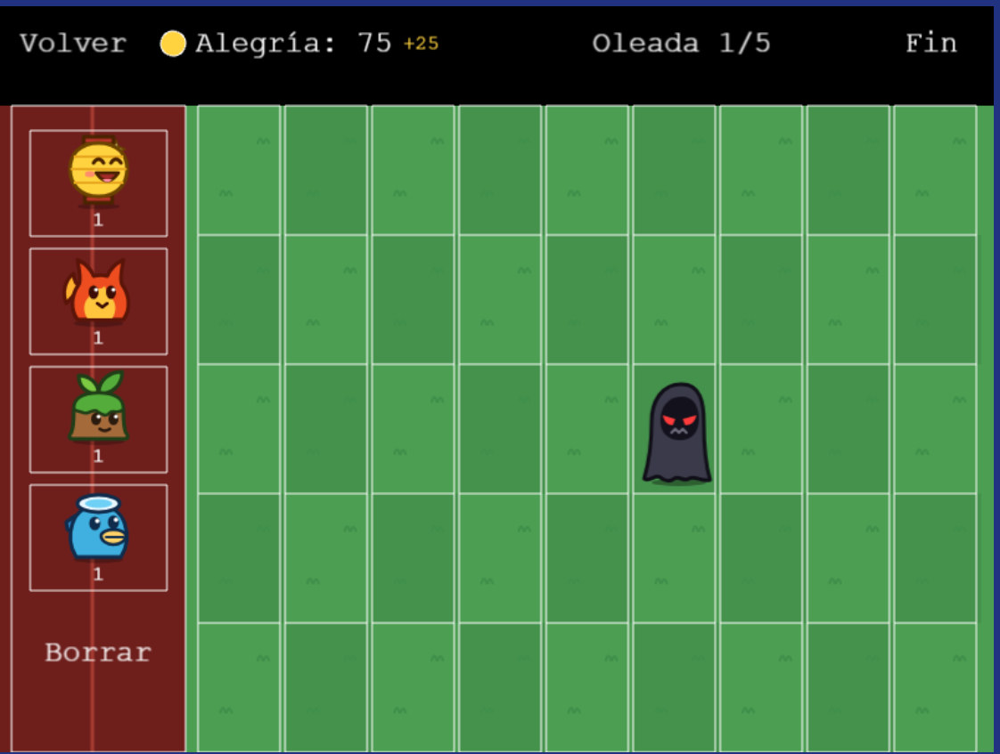

## Yokai Defender
### Grupo-11

https://pvli-grupo11.github.io/Yokai-Defender/

Este proyecto es un trabajo universitario para la asignatura de PVLI (Programación de videojuegos en lenguajes interpretados)

### Descripción:

Yokai Defender es un juego de estrategia tipo tower defense ambientado en un Japón fantástico. El Yokai de la Desesperación y su ejército quieren destruir el templo del Dios Yokai y sumir el mundo en el caos.

Para defender el templo tendrás que gestionar la alegría como recurso e invocar yokais en las distintas filas del campo de batalla. Cada uno tiene sus propias habilidades y tendrás que colocarlos estratégicamente para resistir las oleadas de enemigos.

### Capturas

Campo de batalla:

### Documentación

- [GDD](docs/GDD.md)
- [Assets](assets.md)
