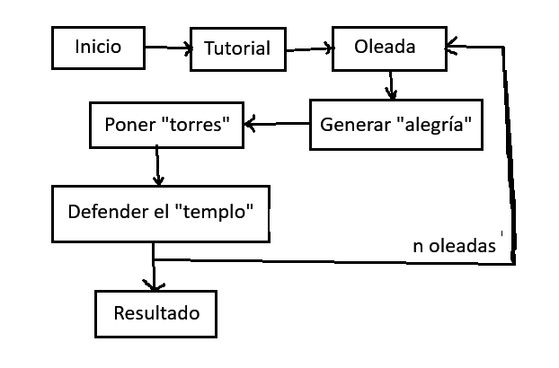
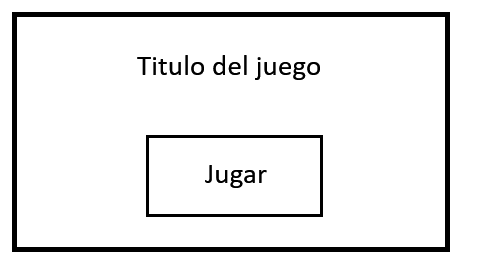
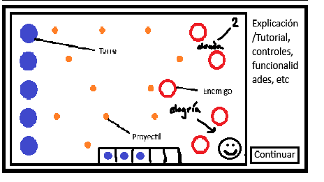
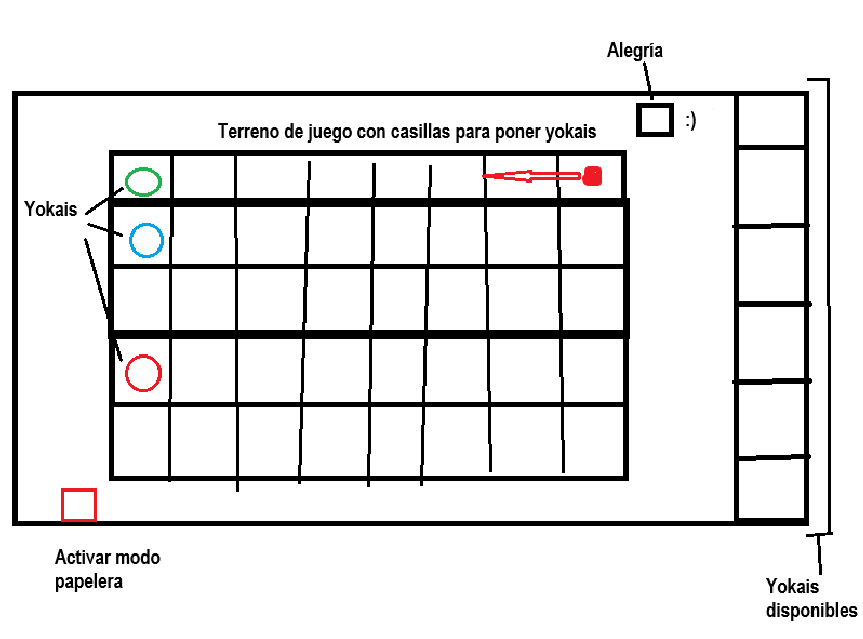
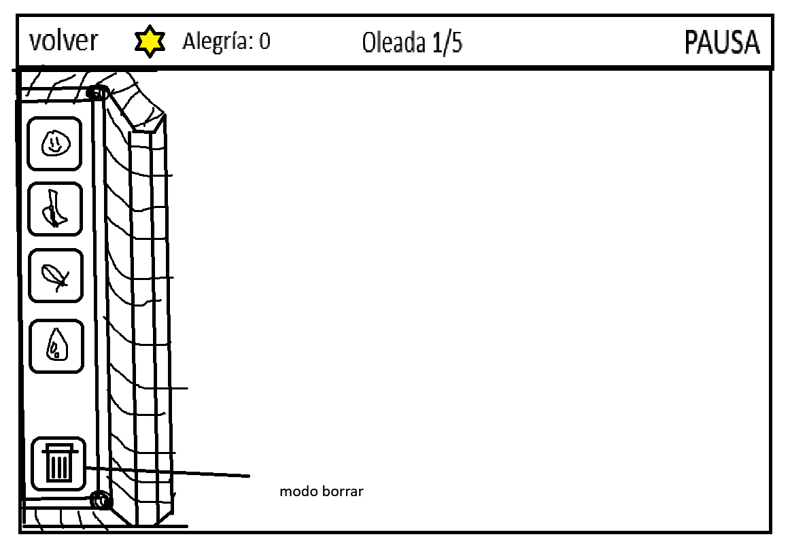
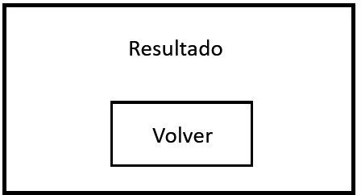
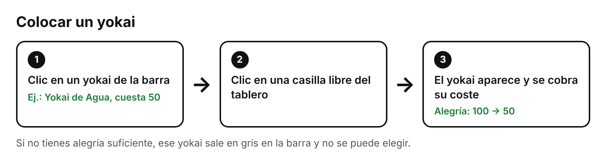
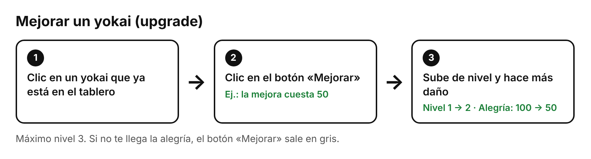
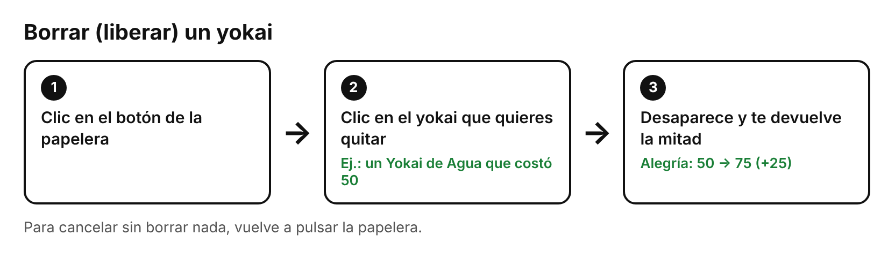
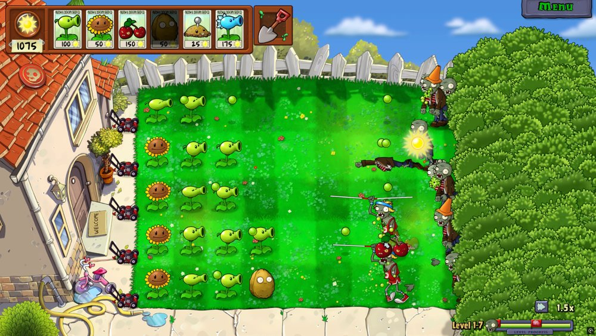

# Yokai Defender

**Documento de Diseño**

**Grupo 11**

Adrián Arbas Perdiguero\
Tomás Arévalo Almagro\
Carlos Dochao Moreno\
Vicente Rodríguez Casado

## Descripción

Juego de tower defense (en horizontal, es decir, en línea recta tipo plantas vs zombies) de defender un templo japonés (o lo que sea que se nos ocurra + caracteres chinos/japoneses en el juego). Adicionalmente habrá un personaje/objeto que represente la alegría (emoción de intensamente) y la ambientación debe ser fantasiosa (yokais, bichos, espectros, etc)

## Género

El juego se clasifica dentro del género tower defender, donde se deberán colocar estructuras en un escenario para detener el avance de una serie de enemigos que irán apareciendo por oleadas.

## Público objetivo

El público objetivo es amplio, especialmente jugadores que disfrutan de juegos estratégicos, que busquen un desafío a la hora de gestionar un escenario y maximizar la eficiencia de sus edificios ante el avance de masas de enemigos que buscarán atravesar sus defensas.

## Setting

El juego transcurre en Japón, en una época contemporánea, donde existen los yokai, y otros seres malignos, que buscan destruir el templo del Dios Yokai (encargado de mantener la pureza y la felicidad en el mundo) para así instaurar un nuevo orden de caos y oscuridad a manos de su líder, el Yokai de la Desesperación. Para ello el Dios Yokai te pedirá ayuda, y te enseñará a invocar a otros yokais que estén dispuestos a luchar por el bien de este mundo.

## Características principales

- Tower defender
- Gestión de "energía" (para invocar los yokai (estructuras de defensa))
- Gestión de casillas dónde se colocarán los yokais
- Experiencia para un único jugador

## Objetivo del juego

El objetivo del juego es sobrevivir a las oleadas de enemigos que irán apareciendo a medida que la partida avance. Para ello usarás un recurso, que es la "energía yokai", para invocar yokais en tus líneas de defensa que lucharán contra las tropas malignas que intentarán llegar al templo situado tras tus líneas de defensa.

## Flujo del juego

### Inicio

El juego empieza en el menú de inicio, donde se podrá acceder al tutorial por medio del botón "JUGAR".

### Pantalla de tutorial

En la pantalla tutorial se mostrará un panel visual estático que explicará los controles básicos sobre administrar las "torres"

### Escenario de combate

En la pantalla de escenario de combate estarán representados por filas horizontales las líneas que defender, a la izquierda estarán las torres defensivas que hayas dispuesto y sobre el lateral izquierdo avanzarán los enemigos por oleadas hacia las torres de manera horizontal y respecto a su correspondiente fila. Asimismo se podrá ver información como el número de oleada, la cantidad de alegría disponible y un botón para acceder al menú de pausa.

### Pantalla de resultado

Esta pantalla muestra el resultado de la partida (victoria o derrota), junto con un botón para regresar a la pantalla de inicio.

## Estética y contenido

El apartado visual va a ser parecido al de plantas vs zombies, un estilo cartoon, simple, y poco detallado, dando más importancia a las siluetas. Buscamos una estética colorida y divertida, que a su vez chocará directamente con una estética más oscura y sombría que se manifestará cuando aparezcan los malos. Mientras los malos no aparezcan todo será precioso y maravilloso, como si no existiese una amenaza que busca conquistar el mundo y esclavizar a los humanos para alimentarse de sus emociones negativas hasta que la desesperación los consuma y solo quede de ellos un cascarón vacío, sin motivación, sin esperanza, sin sueños…

El escenario principal será la entrada de un templo. El templo pertenece al Dios Yokai.

## Narrativa

El Dios Yokai te recluta para que lo ayudes a defenderse del ejército del Yokai de la Desesperación. Este ejército busca destruir el templo del Dios Yokai, dejando así a este sin poder alguna sobre la tierra, y permitiendo así la entrada de todas las hordas malignas atrapadas en el más allá, cuya misión es la conquista absoluta de la humanidad y su esclavitud para alimentarse eternamente estos, mientras el Yokai de la Desesperación gobierna esta tierra muerta y aburrida.

Para ello el Dios Yokai te enseñará a vincularte con la energía yokai, y te enseñará a invocar a los yokais que sí están dispuestos a luchar por el lado del bien, uniendolos a tus filas para detener el avance del maligno.

## Mecánicas

- "Torres" (que disparan proyectiles, que generan "alegría"...), se colocan en las casillas distribuidas por el escenario. Las torres tendrán distintos tipos de proyectiles, algunos golpearán en área, otros atravesarán tropas u otros simplemente chocarán y desaparecerán. Variables: Cooldown de ataque, daño de proyectil, elemento de torre, precio para construirse, nivel actual.

  **Tipos de torres:**

  **Yokai Neutral:** un yokai sin tipo, todos sus ataques hacen x1 de daño a cualquier enemigo, sus proyectiles recorren el carril horizontalmente y ataquen al primer enemigo con el que chocan.

  **Yokai de Fuego:** Su tipo corresponde al elemento Fuego. Su proyectil recorre todo el carril y atraviesa a los enemigos, es una especie de láser que golpea a todos los enemigos en el carril, El yokai de fuego hace x1.5 de daño a los enemigos tipo Planta, y x0.5 de daño a los enemigos tipo Agua.

  **Yokai de Planta:** Su tipo corresponde al elemento Planta. Su proyectil recorre el carril y choca contra el primer enemigo en su camino, Cada tres proyectiles lanzados, el yokai lanzará un proyectil que al chocar contra un enemigo, este provocará que se quede enraizado en el suelo (quedará paralizado durante un tiempo).

  **Yokai de Agua:** Su tipo corresponde al elemento Agua. Su proyectil recorre el carril y choca contra el primer enemigo en su camino. Su proyectil aplica el estado de congelación, el cual reduce la velocidad de movimiento de los enemigos en x0.5

  **Yokai Alegria:** Genera alegría cada x tiempo.

- Elementos - Las torres tendrán elementos relacionados a ellos: Agua, Planta y Fuego. Estos elementos de las torres definirán el tipo de elemento de sus proyectiles. Los distintos tipos de enemigos también tendrán un elemento, lo cual nos permite crear una tabla de ventajas y desventajas. El fuego hace x1.25 de daño a los enemigos de planta, pero hará x0.75 de daño a los enemigos de agua.

- Liberación - Podremos liberar las torres ya colocadas en el terreno de combate con un botón cerca del inventario de torres. Al clicar nos permitirá entrar en modo liberación, y al hacer click en una torre ya colocada, ésta desaparecerá del terreno de combate.

- Devolución de alegría al liberar - Al liberar una torre se devuelve la mitad de la alegría que se gastó en ella (redondeando hacia abajo), así que lo que devuelve depende del tipo de yokai. Por ejemplo, si un yokai costó 50, al liberarlo recuperas 25. En modo liberación, al pasar el ratón por encima de un yokai se ve cuánto devuelve.

- Mejora de torres (upgrade) - Haciendo click en una torre ya colocada aparece el botón "Mejorar". Mejorar cuesta alegría y sube el nivel de la torre (máximo nivel 3): las torres que atacan hacen más daño y el Yokai Alegría genera más alegría.

- Inventario de torres - Las torres se representarán en una hotbar, donde podremos ver la cantidad de puntos de alegría que hay que pagar para ser invocadas. Al hacer click sobre una de las torres activaremos el modo construcción y al clickar en una de las parcelas construibles podremos colocar la torre en esa misma parcela, además se nos cobrarán los puntos de alegría de su coste.

- Colocación de las torres - Se puede colocar una torre en cualquier casilla libre del tablero (una torre por casilla). Cada torre solo ataca a los enemigos de su fila, así que elegir la fila es elegir qué carril reforzar. La columna también importa: los enemigos destruyen la primera torre que se encuentran en su fila, así que conviene poner delante las que atacan y detrás, cerca del templo, los Yokai Alegría.

- Alegría (generas alegría como los soles en el pvsz) se genera pasivamente con el tiempo.

- Enemigos (destruyen "torres" si llegan a ellas en cada fila, por oleadas), que avanzan en línea recta buscando atravesar las líneas defensivas. Habrá diferentes tipos de enemigos, algunos que tengan más vida u otros que sean más rápidos. Variables: Vida, velocidad de movimiento…

  **Tipos de enemigos:**

  **Espíritu Neutral:** Un enemigo de tipo Neutral, es decir que no recibe ni más ni menos daño de ningún elemento. Camina a velocidad constante a lo largo del carril, sin ninguna habilidad especial.

  **Espíritu de Fuego:** Un enemigo de tipo Fuego. Se mueve al doble de velocidad que un enemigo normal. Cada x segundos.

  **Espíritu de Agua:** Un enemigo de tipo Agua. Se mueve más despacio que el resto de enemigos, pero también posee más vida.

  **Espíritu de Planta:** Un enemigo de tipo Planta. Se mueve más despacio de lo normal, se puede regenerar un poco de vida cada x tiempo.

## Interfaz

La interfaz es la básica de un juego de tower defense, tendrás un indicador de cantidad de "alegría" actual almacenada y un indicador de la oleada actual en la que te encuentras. Asimismo tendrás una barra de acceso a las "torres" de las que dispongas en el momento para poner sobre la fila que consideres. Por último un botón de pausa con el que poder acceder a un menú que te lleva a la pantalla de inicio (botón reiniciar partida).

Gasto de alegría en la interfaz: en la barra de torres se ve lo que cuesta cada una, y las que no puedes pagar salen en gris. Cuando gastas alegría (colocar o mejorar) aparece un "-X" junto al indicador de alegría, y cuando la recuperas (liberar) aparece un "+X".

## Flujos de interacción

Los tres flujos principales del jugador durante el combate. Los números son solo un ejemplo.

## Personajes

**Dios Yokai** - El yokai que mantiene el orden en el mundo

**Yokai de la Desesperación** - Yokai encerrado en otro plano que manda a su ejército para destruir el templo del Dios Yokai. Su objetivo es poder atravesar el plano astral y conquistar a la humanidad

**Otros yokais** - Serán los yokais que vayas reclutando por el camino y que te ayudarán a defender el templo del Dios Yokai

## Niveles/Oleadas

Por ahora tenemos pensado hacer un único nivel de 5 oleadas. Las oleadas serán scripteadas, para facilitar el balanceo del juego.

## Referencias

Plantas vs Zombies

## UML de clases
